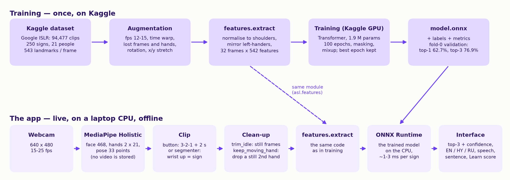

# SLT — team kit

SLT is a Windows program that recognises **American Sign Language (ASL) signs from a webcam**
and shows each recognised word in English, Armenian and Russian. It knows 250 everyday signs,
works offline on an ordinary laptop (no GPU), and has three modes: **Single word**,
**Sentence** and **Learn**.

This folder has everything for the report, the presentation and the contest: results,
figures, screenshots and an explanation of how the system works. Every number here comes from
the project's result files; `METRICS.md` is regenerated by `scripts/make_team_kit.py`.

## What is in this folder

| File | What it is |
|---|---|
| `METRICS.md` | All results: accuracy, how we got there, tests with real signing, speed, limits |
| `figures/architecture.png`, `architecture.mmd` | How the system works (picture + Mermaid source) |
| `figures/accuracy_progression.png` | Accuracy from the first model to the app (one slide) |
| `figures/accuracy_per_participant.png` | Accuracy for each of the 4 test people |
| `figures/top_confusions.png` | Which signs the model mixes up most |
| `figures/signs_easiest_hardest.png` | The 10 easiest and the 10 hardest signs |
| `figures/training_curves.png` | Loss and accuracy during training (100 epochs) |
| `figures/confusion_matrix.png` | Full 250 x 250 confusion matrix (diagonal = correct) |
| `screenshots/` | Every mode, in English (`_en`) and Armenian (`_hy`), taken by the program itself |
| `data/signs_250.csv` | The 250 signs with their Armenian and Russian translations |
| `data/per_sign_accuracy.csv` | Accuracy of every sign on the test people |
| `data/top_confusions.csv` | The 20 most frequent confusions |
| `data/defense_set.csv` | Signs the author has learned and shows reliably — use these in live demos |
| `data/metrics.json` | The model's metrics file, as the app reads it |

## How it works

1. **Camera → body points.** Google's MediaPipe Holistic finds 543 points in every camera frame:
   the face (468), both hands (21 each) and the body (33). From here on the program works only with
   these points. The camera picture is never saved; for the user's attempts only the point
   coordinates are kept.
2. **Points → one clip per sign.** In Single word and Learn mode the user presses Space, a 3-2-1
   countdown runs and 2 seconds are recorded. In Sentence mode a *segmenter* cuts the stream by
   itself: a raised hand means a sign is being shown, a lowered hand means a pause.
3. **Clean-up.** Still frames at the start and the end are cut (`trim_idle`). If both hands are
   visible and one of them does not move, that hand is ignored (`keep_moving_hand`). This one rule
   raised accuracy from 62.7% to 65.1%.
4. **Features.** Every clip becomes the same table of 32 frames x 542 numbers: positions of the
   hands, arms, lips, nose and eyes measured from the shoulders (so the distance to the camera and
   the person's size do not matter), their speeds, whether each hand is visible, and distances
   between the fingertips. A left-handed signer is mirrored so the active hand is always in the
   same place. **Training and the app use exactly the same code for this step**, so the model sees
   the same kind of input in both.
5. **Model.** A small Transformer neural network (1.9 million parameters) reads the table and gives a
   probability for each of the 250 signs. It was trained on Kaggle's GPU with the Google *Isolated
   Sign Language Recognition* dataset (94,477 clips from 21 people) and runs in the app with
   ONNX Runtime on the CPU in about 1-3 ms.
6. **Answer.** The app shows the three most likely signs with their confidence. Below 40% it says
   "not recognised" instead of guessing.

## The modes

- **Single word** — show one sign, get the word in EN / HY / RU and two alternatives; Speak reads
  it aloud. (`screenshots/1_single_*.png`)
- **Sentence** — show several signs in a row with the hand lowered between them; the words line up
  into a sentence. If a word is wrong, tap the right one among its alternatives. There is also a
  manual variant (each word with Space) that is the most reliable on stage.
  (`screenshots/2_sentence_*.png`)
- **Learn** — pick any of the 250 signs, watch a reference performed by a real signer from the
  dataset (as a skeleton, at full or half speed), then try it yourself: the app scores the attempt
  and plays your attempt next to the reference. A sign counts as learned after 3 successful
  attempts. (`screenshots/3_learn_*.png`)
- **Demo mode** — the **?** button (top right) → *Demo 1/2/3* plays the author's recorded sentences through the
  whole pipeline without a camera. This is the backup if the camera fails during the defense.
  (`screenshots/6_demo_*.png`)

The interface is in Armenian (default), Russian or English (HY / RU / EN in the top right corner).

## Numbers to quote

- **62.7%** of signs recognised correctly as the first answer, **76.9%** among the top three — on
  4 people the model never saw during training (18,528 clips). Chance level is 0.4%.
- **65.1%** with the app's full pipeline (the second-hand rule on).
- With the author's own signing: 10 of 10 signs in the first app test, and 15 of 15 words in three
  recorded sentences.
- Speed on a laptop with an Intel Core i3 and no GPU: 16-25 camera frames per second, a few
  milliseconds to recognise a sign.

Please quote them honestly:

- These numbers come from **one split** of the data (4 test people). Accuracy differs from person
  to person: 57-71%.
- The 64.1% "with near-synonyms merged" (e.g. *give/gift*, *awake/wake*) is **not** the model's
  accuracy. Show it only with that label, next to the real number.
- The author's own tests use signs the author practised (`data/defense_set.csv`); they show the
  app works live, not that it knows every sign equally well.

## Limitations

- **Isolated signs, not translation.** SLT recognises single signs (or a row of single signs with
  pauses). It does not understand ASL grammar, so it cannot translate signed sentences into
  grammatical English, Armenian or Russian.
- Only the 250 signs of the dataset, not the whole of ASL. No fingerspelling, no facial grammar.
- Signs that look alike are confused (*give/gift*, *goose/duck*, *dad/grandpa*).
- Two-handed signs where the second hand is still may lose that hand (the second-hand rule).
- Armenian words are shown as text; spoken output is English (Windows voice) until Armenian
  recordings are added.

## Running the program

- The built program is the folder `SLT` (from `dist\SLT`): double-click `SLT.exe`. No Python or
  installation is needed. Copy the whole folder, not just the exe.
- Without a camera: the **?** button → *Demo 1/2/3*, or start `SLT.exe --demo 1`.
- Settings, learning progress and logs are saved next to `SLT.exe` (`settings.json`,
  `progress.json`, `logs\`).

## Credits

- Data: Google — Isolated Sign Language Recognition (Kaggle competition dataset).
- Libraries: MediaPipe (Apache 2.0), ONNX Runtime (MIT), Qt for Python / PySide6 (LGPL v3),
  OpenCV (Apache 2.0), NumPy (BSD); training with PyTorch (BSD) on Kaggle.
- Fonts: Rubik and Noto Sans Armenian (SIL Open Font License 1.1, in the program's `assets/fonts`).
